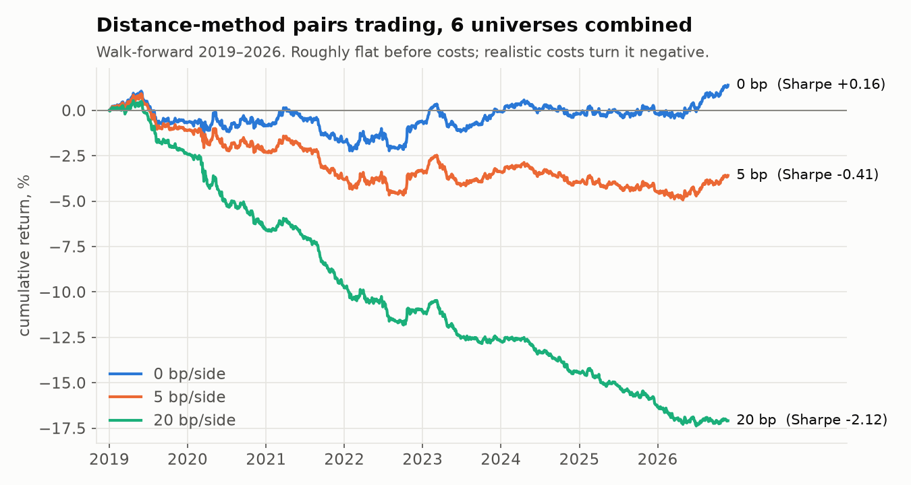
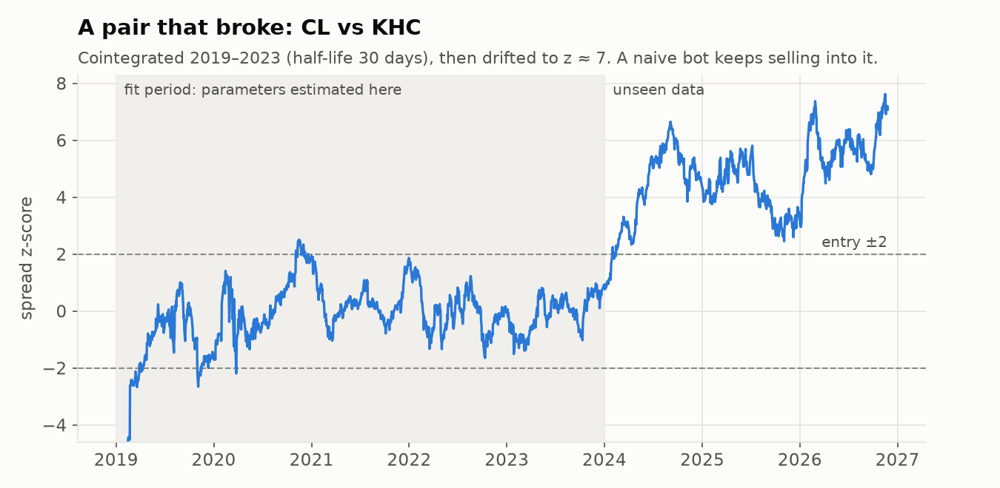
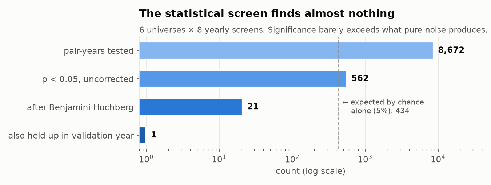

# Pairs Trading, Tested Honestly


A statistical-arbitrage research project: find stock pairs whose spread mean-reverts, model the
spread as an **Ornstein-Uhlenbeck process**, track the hedge ratio with a **Kalman filter**, and
run a **walk-forward backtest** with realistic costs on daily data from Alpaca (2016–2026).

**Result: after costs, pairs trading did not make money on these ~120 US stocks and ETFs from
2019 to 2026.** The code finds planted pairs in synthetic data, so this reflects the market, not a bug.
The project's value is in how carefully that conclusion was reached.



## Key findings

1. **Multiple testing decides everything.** Across 8,672 pair-years, 6.5% look "cointegrated"
   at p < 0.05, barely above the 5% that pure noise produces. After Benjamini-Hochberg and an
   out-of-sample check, **1** survives.
2. **Pairs break.** Pairs that were cointegrated for years, like Colgate / Kraft Heinz, drifted 7
   standard deviations apart once the out-of-sample period began.
3. **Two common Kalman-filter setups find pairs in pure noise.** The textbook random-intercept
   model and a level-space model both did. The fix: model daily returns with the OU spread as a
   state, and test the self-financing portfolio you'd actually hold.
4. **Costs eat what's left.** The standard academic benchmark (Gatev et al. 2006 distance
   method) earns Sharpe +0.16 before costs (t = 0.46) and −0.41 at 5 bp per side.

## What's in the repo

| Stage | What it does | Code |
|---|---|---|
| 1. Screen | Engle-Granger cointegration, Benjamini-Hochberg FDR, OU fit, out-of-sample ADF | `src/screen.py`, `src/ou.py` |
| 2. Kalman | Time-varying hedge ratio, OU spread as a state, MLE, numba-compiled filter | `src/kalman.py` |
| 3. Backtest | Walk-forward yearly re-selection, 1-day execution lag, per-side costs + borrow | `src/backtest.py` |
| 4. Paper trading | Not started: the backtest gave no strategy worth running | |

16 tests (`tests/`) cover the math and the pipeline, including synthetic ground-truth checks,
a no-look-ahead test, and tests that reproduce both Kalman traps.

## Quick start

```bash
git clone https://github.com/sashakrem/alpaca-pairs && cd alpaca-pairs
python -m venv .venv && source .venv/bin/activate   # Windows: .venv\Scripts\activate
pip install -r requirements.txt
python -m pytest                                    # no API keys needed
python run_screen.py --demo                         # synthetic market, no keys needed
python run_backtest.py --demo --select coint distance
```

For real data, copy `.env.example` to `.env` and add free Alpaca **paper-trading** keys, then:

```bash
python run_screen.py --universe staples [--method kalman]
python run_backtest.py --universe all --select coint distance --costs 0 5 10 20
python make_figures.py                              # regenerate the charts in docs/figures/
```

## Stage 1: the math

**Cointegration.** Two prices can each be random walks while a linear combination
`log Y − β log X − α` is stationary. That combination, the spread, is what we trade.
It's tested with Engle-Granger: OLS for β, then an ADF unit-root test on the residuals.

**Multiple testing.** 10 stocks give 45 pairs, and 20 stocks give 190. At α = 0.05 you expect
about 5% of unrelated pairs to look cointegrated by chance. The screener:
1. runs Engle-Granger in both directions and Bonferroni-corrects the better one (×2), and
2. controls the false discovery rate across all pairs with Benjamini-Hochberg.

**Spread dynamics.** The spread is modeled as an OU process:

$$dX_t = \theta(\mu - X_t)\,dt + \sigma\,dW_t$$

Sampled at interval Δt, it is exactly an AR(1) with coefficient `b = e^{-θΔt}`, so OLS on
`X_{t+1} = a + bX_t + ε` gives θ, μ, σ. From those:
- **half-life** `ln 2 / θ`: how fast mispricings close (we want roughly 2–60 trading days)
- **stationary std** `σ / √(2θ)`: the natural unit for z-score entry and exit signals

**Out-of-sample validation.** β, α and the OU parameters are estimated on a formation period
and then *frozen*. The holdout spread is re-tested for stationarity. Pairs that break are rejected.

**Numerical note.** `simulate_ou` implements both the exact transition density and
Euler-Maruyama. Euler's AR coefficient is `1 − θΔt` instead of `e^{−θΔt}`, so it biases θ
and is unstable for `θΔt > 2`. `tests/test_core.py` demonstrates the bias.

## Stage 2: time-varying hedge ratio (Kalman filter)

A fixed β assumes the relationship between two companies never changes. The Kalman filter
lets β drift slowly and re-estimates it every day. Getting this right took three tries, and
the two failures are the interesting part.

**Trap 1: the textbook model finds pairs in pure noise.** The usual setup lets an intercept
and β follow random walks and trades the filter's forecast error. Fitted by maximum likelihood,
the intercept absorbs the spread, so the forecast error looks stationary for *any* two stocks.
On two independent random walks it gives ADF p ≈ 0 (`test_textbook_random_walk_intercept_model_finds_fake_pairs`).

**Trap 2: writing the model in price levels.** `log Y_t = β_t log X_t + m_t` looks fine,
but log prices sit around 4, so a small move in β_t shifts Y by about 4·Δβ and acts as a free
intercept. In synthetic tests this made one leg of a real pair look "cointegrated" with
every unrelated stock (14 false candidates in one 153-pair market). The β that fits levels also
isn't the β that hedges returns, so it lagged real drift.

**The model used.** Written in daily log returns, with the OU spread as an explicit state:

$$\Delta y_t = \beta_t\,\Delta x_t + (m_t - m_{t-1}) + v_t,\qquad \beta_t = \beta_{t-1} + w_t,\qquad m_t = \varphi\, m_{t-1} + \eta_t$$

State `s_t = [β_t, m_t, m_{t-1}]`, transition `F = [[1,0,0],[0,φ,0],[0,1,0]]`, observation row
`H_t = [Δx_t, 1, −1]`. φ = e^{−θ} links it to the OU SDE, so the half-life is −ln 2 / ln φ.
The four parameters (q, φ, σ²_η, r) are fitted by maximizing the prediction-error log-likelihood
from 9 starting points, because the likelihood has competing local optima. The filter loop is
compiled with numba (about 30× faster), and a test checks it against a plain matrix implementation.

**What gets tested is the portfolio, not the filter's state.** Selection uses the value of the
self-financing portfolio you'd actually hold (long Y, short β_{t−1}·X, rebalanced daily):

$$V_t = \sum_{s \le t} \left(\Delta y_s - \beta_{s-1}\,\Delta x_s\right)$$

V can't profit from β moving, only from real co-movement. A pair is a candidate if V has an OU
half-life of 1–60 days in formation, V passes ADF on the holdout (frozen parameters,
Benjamini-Hochberg across all pairs), and V's holdout half-life is also in range.

The holdout ADF includes a linear trend (`regression="ct"`). I added this **after** a control
pair failed: GLD and IAU (two gold ETFs) differ in fees by 0.15%/yr, so their hedged portfolio
drifts slowly downhill. Without the trend term the test rejects them (p = 0.87); with it they
pass (p = 0.002). The change was made on a control pair, before rerunning the sector screens,
and the calibration below was rerun with it.

### Calibration: 12 synthetic markets, 2,700 unrelated pairs, 54 planted pairs

| Hedge-ratio drift (in returns) | Static (stage 1) found | Kalman found | False positives: static / Kalman |
|---|---|---|---|
| none | **18/18** | 11/18 | 0 / 2 |
| 30% over the sample | **18/18** | 11/18 | 0 / 0 |
| 100% over the sample | 7/18 | **11/18** | 0 / 0 |

The Kalman screen's 2 false positives out of 35 discoveries (≈6%) match the 5% FDR target.
**Conclusion:** the Kalman filter is worth it only when hedge ratios drift a lot. Otherwise a
fixed β is more powerful, because it has fewer parameters to estimate.

### Results on real data (formation 2019–2023, holdout 2024–Nov 2026)

| Universe | Static candidates | Kalman candidates |
|---|---|---|
| staples, banks, energy, semis, utilities (225 pairs) | 0 | 0 |
| control: GLD/IAU, SPY/IVV, GOOGL/GOOG, EWA/EWC | 0 | 1 (GLD/IAU) |



No large-cap pair in these sectors held up out of sample with either method. The pairs that
passed formation (e.g. CL/KHC, BAC/PNC) broke in 2024–26. Some are far from their mean
(CL/KHC at z ≈ 7), and a naive strategy would keep adding to that losing position. The likely
reasons: these are heavily traded stocks where simple pairs have been arbitraged away, and
2020–2023 included regime changes (COVID, rate hikes).

## Stage 3: walk-forward backtest

`src/backtest.py`, `run_backtest.py`. Every trading year from 2019 to 2026:
pick pairs using **only** earlier data, freeze all parameters, then trade the year.

**Rules, fixed before any results were seen:** enter at |z| > 2 (but not beyond the stop),
exit at |z| < 0.5, stop-loss at |z| > 4, time stop at 3× half-life, flat at year end.
Orders execute one day after the signal. Each pair is $1 gross (dollar-weighted legs),
and capital is split across max(#pairs, 5) slots. **Costs:** 5 bp per side for slippage and
half-spread, plus 0.5%/yr to borrow the short leg. Results are also shown at 0, 10 and 20 bp.
Tests check a hand-computed trade, per-side cost accounting, year-end closing, and that
scrambling future prices can't change past returns (no look-ahead).

**Universes:** 6 × ~20 names, mid caps included (regional banks, utilities, energy, REITs,
staples, country ETFs), with daily data from 2016.

Two ways to pick pairs, with the same trading rules and costs:
- **`coint`:** the stage-1 statistical screen. 3-year window: fit on 2 years, validate on the 3rd.
- **`distance`:** the Gatev-Goetzmann-Rouwenhorst (2006) benchmark. Each year, trade the 5 pairs
  whose normalized prices tracked each other most closely over the previous 12 months.
  No significance test. (GGR trade for 6 months and use no stop; this version uses the rules above.)

### Results



**Statistical screen: almost nothing to trade.** Out of 8,672 pair-years, 562 (6.5%) were
significant before correction. If no pair were real, chance alone would give 5%. After
Benjamini-Hochberg, 21 remained, and 1 also held up in the validation year. One pair traded
twice in 8 years. The thresholds were **not** loosened to produce trades.

**Distance method: trades a lot, earns nothing.**

| Universe | Sharpe, 0 bp | Sharpe, 5 bp | Sharpe, 20 bp | Trades |
|---|---|---|---|---|
| banks | +0.16 | −0.08 | −0.82 | 259 |
| utilities | −0.24 | −0.60 | −1.67 | 290 |
| energy | +0.32 | +0.19 | −0.20 | 215 |
| REITs | −0.04 | −0.34 | −1.21 | 221 |
| staples | −0.01 | −0.20 | −0.80 | 247 |
| country ETFs | −0.07 | −0.48 | −1.67 | 277 |
| **all 6 combined** | **+0.16** (t = 0.46) | **−0.41** (t = −1.16) | | 1,509 |

The best single result (energy, +0.19 after costs) is the best of 6 tries and has t ≈ 0.5, so it isn't
evidence of anything. Why it loses: 817 of 1,509 trades hit the stop-loss (average −1.2%).
The spread usually keeps widening instead of reverting. Trades that do revert earn +2.8%, but there
are too few of them. This matches the literature: Do & Faff (2010) found distance-method profits
largely disappeared after 2002.

On synthetic data with planted pairs, the same code earns Sharpe +1.6 (coint) and +0.7 (distance)
after costs, so the negative result reflects the market, not a bug.

**Conclusion:** after realistic costs, neither method makes money in these universes from 2019 to 2026.
Per the project plan, nothing is promoted to paper trading on the strength of this backtest.

```bash
python run_backtest.py --demo --select coint distance
python run_backtest.py --universe all --select coint distance --costs 0 5 10 20
```

## Validation on synthetic data

`python run_screen.py --demo` builds a market of 12 random walks plus 3 planted cointegrated
pairs with known β and half-life. Result: 12 pairs look significant without correction, 5 survive
FDR control, and both pairs flagged as candidates are planted ones with β and half-life
recovered. One planted pair fails the holdout ADF test (p = 0.07): with about 190 holdout days,
ADF has limited power. That's the false-negative cost of a strict filter.

## Command reference

`run_screen.py`: `--universe` (`banks`, `energy`, `staples`, `semis`, `utilities`, or a wide universe
such as `banks_wide`) or `--symbols A B C`; `--method static|kalman`; `--demo [--beta-drift 1.0]`.
`run_backtest.py`: `--universe NAME|all`, `--select coint distance`, `--costs 0 5 10 20`.
Outputs go to `results/`; downloaded prices are cached in `data/`. Both are git-ignored.

## Known limitations
- **Survivorship bias:** universes are built from companies that exist today, so failed and acquired companies are missing.
- **Engle-Granger** assumes a single cointegrating vector. Johansen is the multivariate generalization (planned).
- **Kalman sensitivity:** with a stable β it finds fewer real pairs than the static screen (11/18 vs 18/18).
- **ADF over-rejects** when a random walk carries large stationary noise (Schwert, 1989). If one
  stock has strong mean reversion of its own, it can occasionally pair with an unrelated stock.
  The out-of-sample half-life check catches most of these.
- **Backtest simplifications:** daily closes only (no intraday fills), constant dollar weights
  with daily rebalancing that is not charged costs, idle cash earns 0, no short-sale availability constraints.
- **Only one hedge ratio per pair.** Baskets (Johansen) are not yet supported.

## References

- Engle & Granger (1987). Co-integration and error correction. *Econometrica* 55(2).
- Benjamini & Hochberg (1995). Controlling the false discovery rate. *JRSS B* 57(1).
- Schwert (1989). Tests for unit roots: a Monte Carlo investigation. *JBES* 7(2).
- Gatev, Goetzmann & Rouwenhorst (2006). Pairs trading: performance of a relative-value arbitrage rule. *RFS* 19(3).
- Do & Faff (2010). Does simple pairs trading still work? *Financial Analysts Journal* 66(4).
